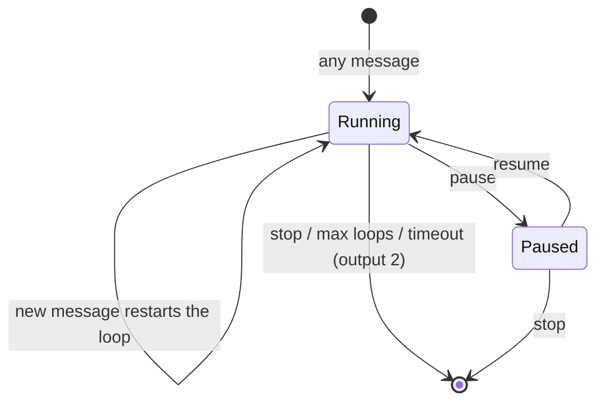

<div align="center">

# ⏱️ Advanced Looptimer for Node-RED

**A message loop with brains: repeat a `msg` on an interval, then stop, pause or resume it, and reconfigure everything per message.**

[](https://www.npmjs.com/package/node-red-contrib-looptimer-advanced)
[](https://www.npmjs.com/package/node-red-contrib-looptimer-advanced)
[](https://github.com/Haxiboy/node-red-contrib-looptimer-advanced/actions/workflows/ci.yml)
[](https://flows.nodered.org/node/node-red-contrib-looptimer-advanced)
[](LICENSE)

</div>

---

## Highlights

- 🔁 **Repeat a message** once per interval (milliseconds to days) with an optional maximum loop count and maximum run time.
- 🛑 **Stop** with a payload, **⏸ pause and ▶ resume** without losing the loop counter or the timeout budget.
- 🧩 **Reconfigure per message** with `msg.loop`: interval, limits and commands, no redeploy needed.
- 🎯 **Exact counts**: optionally make *Max Loops* mean the total number of messages, including a single call.
- 🧪 **Tested and dependency free**: plain timers, an automated test suite and CI on Node.js 18 – 24.
- 🔒 **Backwards compatible**: flows built with 0.0.x keep working unchanged, every new feature is opt-in.

## Installation

Use **Menu → Manage palette → Install** and search for `node-red-contrib-looptimer-advanced`, or:

```bash
cd ~/.node-red
npm install node-red-contrib-looptimer-advanced
```

Requires **Node-RED 3.0+** and **Node.js 18+**. Older runtimes can stay on `0.0.x`.

## Quick start

An [example flow](examples/Example%20Flow.json) is included (*Import → Examples* in the editor, or paste the file). In short:

1. Wire an **inject** node into *looptimer-advanced*, set *Loop Every* to `1 Second` and *Max Loops* to `10`.
2. Output 1 emits your message immediately and then once per second; output 2 reports `max loops reached`.
3. Send a message with payload `stop` to the same node to end the loop early.



## Outputs

| Output | Sends |
|---|---|
| **1** | The original message immediately, then one copy per loop. The first copy after a resume carries `msg.pauseduration` (ms). |
| **2** | Status messages with these payloads: `stopped`, `max loops reached`, `timeout`, `paused`, `resumed`. |

## Controlling the loop

| How | What it does |
|---|---|
| `msg.payload = "stop"` (or `"STOP"`) | Stops the loop |
| `msg.payload = "pause"` / `"resume"` | Pauses / resumes (enable *Pause / resume with payload* in the node) |
| `msg.loop.command = "stop"`, `"pause"` or `"resume"` | Same, but always available and independent of the payload |
| Any other message | Starts the loop, or restarts it. Two loops never run in parallel in one node |

Pausing freezes the remaining time of the current interval, the loop counter and the timeout budget. Resuming continues from exactly there. Stopping while paused works too.

## Overriding settings with `msg.loop`

| Property | Type | Description |
|---|---|---|
| `msg.loop.duration` | number | Loop interval |
| `msg.loop.units` | string | `Millisecond`, `Second`, `Minute`, `Hour`, `Day` |
| `msg.loop.maxloops` | number | Maximum number of loops |
| `msg.loop.totalcount` | boolean | *Max Loops* counts the first message too |
| `msg.loop.maxtimeout` | number | Maximum run time of the loop |
| `msg.loop.maxtimeoutunits` | string | Same units as above |
| `msg.loop.command` | string | `stop`, `pause` or `resume` |

```js
// Function node: loop every 30 seconds, at most 10 times
msg.loop = { duration: 30, units: "Second", maxloops: 10 };
return msg;
```

Overrides stay in effect for the following messages (as they always did). In a function node create the object first: `msg.loop = { maxloops: 5 };`, never `msg.loop.maxloops = 5` on its own.

## How loops are counted

By default the first message is not part of the loop, so *Max Loops* `5` gives **6** messages: 1 original + 5 loops. This keeps compatibility with `node-red-contrib-looptimer`.

Tick **Max Loops counts the first message too** (or send `msg.loop.totalcount = true`) for exact counts:

| Max Loops | Default (legacy) | Exact count |
|---|---|---|
| `-1` | loops until timeout or stop (the legacy way is `0`) | unlimited |
| `0` | unlimited | no message at all |
| `1` | 2 messages | **1 message** (a single call) |
| `5` | 6 messages | **5 messages** |

## Versioning

Since **1.0.0** the package follows [Semantic Versioning](https://semver.org/) and keeps a [changelog](CHANGELOG.md) in the [Keep a Changelog](https://keepachangelog.com/) format.

| Bump | Meaning |
|---|---|
| **patch** `1.0.x` | Bug fixes only |
| **minor** `1.x.0` | New, backwards compatible features |
| **major** `x.0.0` | Breaking changes (including raising the minimum Node-RED / Node.js version), always called out in the changelog |

Releases are tagged `vX.Y.Z` on GitHub. The old `0.0.x` numbering was one increment per change and carried no compatibility promise. `1.0.0` marks the first release with a stable, tested public interface: the node's properties, `msg.loop` and the output payloads.

## Upgrading from 0.0.x

Nothing to change in your flows. What is different:

- The `loop` dependency is gone and the node runs on plain timers. A `stop` that arrived between two iterations is no longer lost, and no timer is left running after stop or redeploy.
- A loop that hits its maximum timeout now always reports `timeout` on output 2 (before it sometimes ended silently). The old single-call workaround (`maxloops: 0` with a tiny `maxtimeout`) still works.
- Invalid `msg.loop` values are reported through normal error handling, so a **Catch** node sees them.
- Minimum versions: Node-RED 3.0 and Node.js 18.
- A payload of `pause` or `resume` is only treated as a command when the option is ticked. Existing nodes have it **off**, so such payloads loop like any other value.

## Contributing

Issues and pull requests are welcome.

```bash
git clone https://github.com/Haxiboy/node-red-contrib-looptimer-advanced.git
cd node-red-contrib-looptimer-advanced
npm install
npm test
```

## Credits and license

Based on **node-red-contrib-looptimer** and **node-red-contrib-looptimer2**, with the addition of per-message overrides, pause/resume and exact counting. Released under the [Apache-2.0 license](LICENSE).
